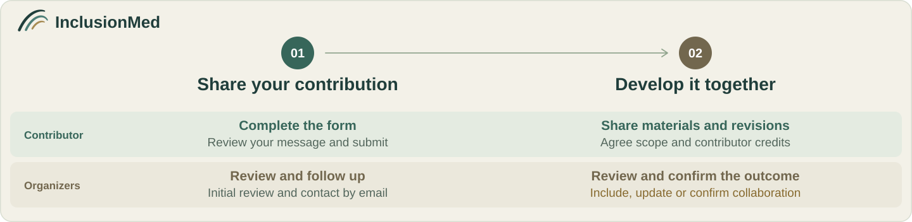

# Contributing to InclusionMed

[Project overview](README.md) · [Website](https://panuvi.github.io/inclusionmed/)

Bring a healthcare task, recommend a benchmark or share expertise. An idea is enough to start; collaborators can help prepare data and code.

## Where to start

| Contribution | What to share |
| :--- | :--- |
| **Healthcare task** | The need it addresses and an example, if available |
| **Existing benchmark** | A reference or link and why it may be useful |
| **Review or expertise** | Your relevant background and how you might help |

The following process applies to task and benchmark proposals.

## From proposal to inclusion

### 1. Prepare a proposal

Start with a short description of the healthcare need or benchmark and why it matters. An example or reference is helpful if available. The [proposal template](assets/docs/inclusionmed-task-proposal.md) can be filled in gradually with collaborators; a dataset, implementation or evaluation run is not needed to start. Unknown details can be left open for discussion.

Do not include patient identifiers, credentials or restricted source data in shared text, attachments or logs. Discuss protected materials and access arrangements with the organizers.

### 2. Initial review

The organizers discuss the proposal's relevance, available evidence, overlap, use conditions and feasibility. They may:

- **Proceed to detailed review:** define scope, required materials, collaborators and the next step.
- **Request information:** identify the questions and evidence needed to proceed.
- **Defer or decline:** explain the reasons and any conditions for reconsideration.

The organizers and contributors agree on the next steps, scope and support as the proposal develops.

### 3. Prepare materials, review and reproduce

Prepare the review package using [Data and code baseline v0.1](assets/docs/task-format.md). Include versioned links to the following materials:

| Material | Required content |
| :--- | :--- |
| Task description | Intended users, scope, input, expected output, interaction, version, languages and coverage |
| Data and references | Field definitions, sample IDs, splits, sources and permissions, reference answers or rubrics, human review record |
| Code and environment | Pinned code and dependencies, configuration, setup, small-trial, full-evaluation and scoring commands |
| Runs and results | Small-sample checks, full evaluation outputs, failures and an [evaluation record](assets/docs/inclusionmed-evaluation-checklist.md) |

Contributors and collaborators can share data preparation and implementation. Existing benchmarks can retain upstream formats and provide an adapter, preserving original IDs, versions and mappings. The organizers identify missing materials and who will prepare them.

Medical reviewers check professional evidence, reference answers, rubrics and critical errors. Technical reviewers check formats, execution, scoring and failure handling. An authorized reviewer who did not produce the reported run independently reproduces the agreed scope and records versions, configuration, results and discrepancies. Agree access approvals, compute and costs before running controlled-data evaluations.

### 4. Revise and review again

Address the review feedback and provide updated materials with a summary of changes and completed checks.

Changes to the objective, scope, data permissions or scoring require the organizers to revisit the relevant initial-review decisions. Formatting and implementation fixes go directly to revision review. Record execution failures and rerun plans separately. Changes to data, prompts or scoring require a new task version; previous results keep their original version.

Reviewers confirm that the required changes are complete. The organizers then record **accept, request further revisions, defer or decline**, with reasons.

### 5. Include and release

The organizers confirm that professional review, technical checks and independent reproduction are complete and that issues affecting validity are resolved. The final reviewer must be independent of the contribution; reviewers disclose relevant conflicts of interest.

The inclusion record names the task version, review decision, reproduction evidence, scope, limitations, contributor roles and maintenance contact. Before release, confirm which materials will be public, which require controlled access and the release date. Include versioned data, code and release links in the record.

Task inclusion and result publication are recorded separately. Task acceptance does not automatically admit every evaluation result. Agree any paper authorship with the project team before publication.

## Review timing

Review timing depends on the proposal, available reviewers, materials and access. Contributors and organizers can agree on next steps and timing as the work develops.

## Data and code baseline

See [Data and code baseline v0.1](assets/docs/task-format.md) for fields, examples and package layout. Review packages follow these conventions:

Contributors define evaluation methods according to their task goals. Document the judgment criteria, metric meanings, calculation or decision procedure, and handling of failures, missing results and retries. Each task determines its dimensions, scales, weights, thresholds and aggregation; organizers review the supporting evidence and reproducibility.

The examples below describe different aspects of a task: MCQ and QA describe answer formats, while Agent describes interaction with tools or an environment. They can overlap, and other formats are welcome. Document the actual input, output, interaction and evaluation method rather than selecting one exclusive type.

| Example pattern | Input and output | Scoring materials |
| :--- | :--- | :--- |
| **[MCQ](assets/docs/task-format.md#mcq)** | Question, context and choices; return one or more choice IDs | Answer evaluation method, chosen metrics and judgment criteria |
| **[QA](assets/docs/task-format.md#qa)** | Prompt or conversation context; return a free-text answer | Task-defined evaluation method, human-reviewed criteria and disagreement resolution |
| **[Agent](assets/docs/task-format.md#agent)** | Goal, initial environment and available tools; return a result or artifact | Environment reset, action and resource limits, completion criteria, state verification and complete tool traces |

- **Data:** use UTF-8 JSONL, one object per sample, with stable unique IDs. Store model inputs separately from answers and rubrics. Document sources, licences, splits, duplicates, languages and population coverage.
- **Professional evidence:** qualified people author and review reference answers and evaluation criteria, recording sources, scope and any task-defined answer variants or critical errors. LLM-generated annotations cannot serve as the reference standard. Disclose AI assistance and human review.
- **Code:** use Python 3.11 as the baseline for new implementations, 4-space indentation and Ruff formatting and linting. Existing implementations can retain their language and tools. Separate loading, model calls and scoring; pin dependencies and provide repeatable commands.
- **Results:** link outputs to sample IDs, task versions and run IDs. Record success, invalid output, timeout, tool error, infrastructure error and unrun cases. Retain failed samples and state scoring rules, denominators and incomplete work.
- **Checks:** provide a small trial covering fields, ID alignment, scoring and failures; add reset, state and trace checks when the task uses tools or an environment. Deliver large files through versioned links; read credentials from environment variables.
