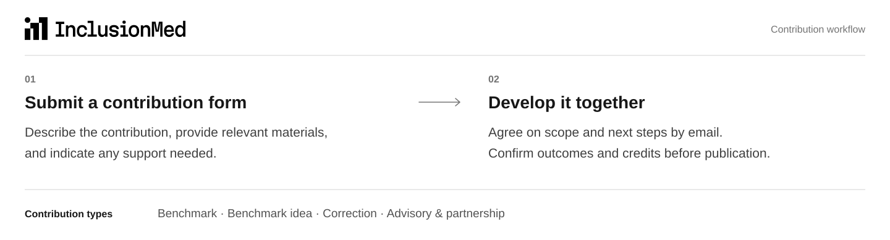

# Contributing to InclusionMed

[Project overview](README.md) · [Website](https://inclusionmed.ai/) · [Contribution form](https://inclusionmed.ai/#/contribute)

InclusionMed accepts contributions to benchmark coverage, evaluation resources, result accuracy and interpretation. Participation is open to individuals and organizations across clinical practice, research, engineering and community health.

## Contribution types

| Contribution | Initial information |
| --- | --- |
| **Benchmark** | Evaluation objective, intended users, and links to available benchmarks, datasets or evaluation tools. |
| **Benchmark idea** | Healthcare need, intended users, care setting and proposed evaluation objective. |
| **Correction** | Affected Atlas or Index entry, result or description, proposed revision and supporting evidence. |
| **Advisory & partnership** | Relevant expertise or organizational interests, proposed scope, availability and support needed. |

## How to participate

### 1. Submit a contribution form

Use the **[Contribute page](https://inclusionmed.ai/#/contribute)** to describe the contribution, provide contact details and relevant materials, and indicate any support needed. An initial benchmark idea does not require a completed dataset, implementation or evaluation run. The [proposal template](assets/docs/inclusionmed-task-proposal.md) supports subsequent development; contributors can leave unresolved details open for discussion.

Contributions and inquiries may also be sent to **[info@inclusionmed.ai](mailto:info@inclusionmed.ai)**. Share only materials permitted for disclosure. Describe access conditions for protected materials without including patient identifiers, credentials or restricted data.

### 2. Develop it together

The team follows up by email to clarify scope and agree on next steps. The subsequent work depends on the contribution:

- **Benchmarks** undergo review, independent reproduction and any necessary revisions. Accepted benchmarks are released with their scope, limitations and contributor credits.
- **Benchmark ideas** are developed into an initial task through discussion of the healthcare need and evaluation objective. Any resulting benchmark follows the same review process.
- **Corrections** are assessed against the affected entry and supporting evidence. Verified corrections are published with their sources and contributor credits.
- **Advisory roles and partnerships** are confirmed after agreement on scope, responsibilities, availability and recognition.

Before publication or announcement, the team and contributor confirm the outcome and contribution credits. Timing depends on the scope, available materials, reviewers and access conditions.

## Benchmark assessment

Benchmark contributions are assessed using the six criteria described in the [project principles](README.md#rationale-and-principles): healthcare relevance; trustworthiness; availability and permitted use; complementary coverage; timeliness and data independence; and discriminative capacity. The same criteria apply to public and private benchmarks. Human review accompanies assessment, and independent reproduction precedes inclusion.

The team and contributors agree on the materials and reproduction scope. Existing benchmarks may retain their upstream formats and provide a field mapping or adapter, preserving original identifiers and versions. Evaluation methods, reference standards, failure handling and limitations should be documented according to the benchmark's own protocol.

## Supporting materials

These resources support benchmark development and detailed review; they are not prerequisites for submitting an initial idea.

- [Proposal template](assets/docs/inclusionmed-task-proposal.md): healthcare need, evaluation scope, available materials and collaboration requirements.
- [Data and code baseline](assets/docs/task-format.md): example formats, package organization, execution and scoring records.
- [Evaluation-record checklist](assets/docs/inclusionmed-evaluation-checklist.md): configuration, results, limitations and independent reproduction.
- [Methodology](https://inclusionmed.ai/#/methodology): benchmark assessment, model evaluation and Index aggregation.
