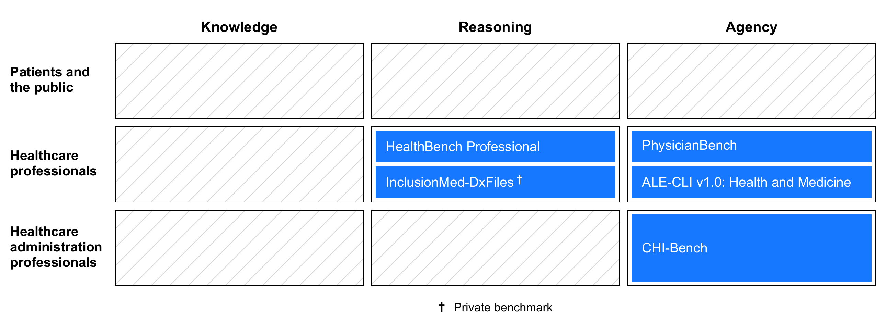
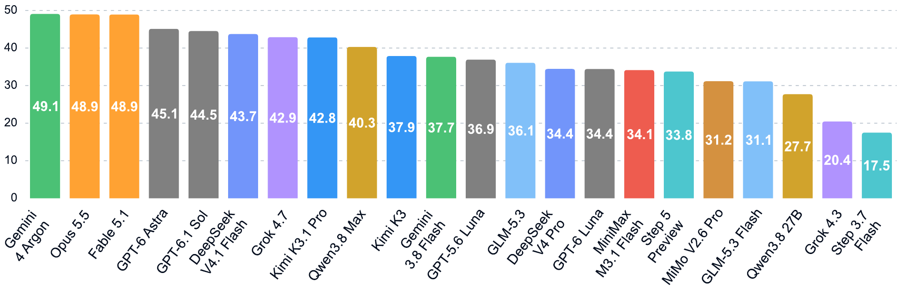
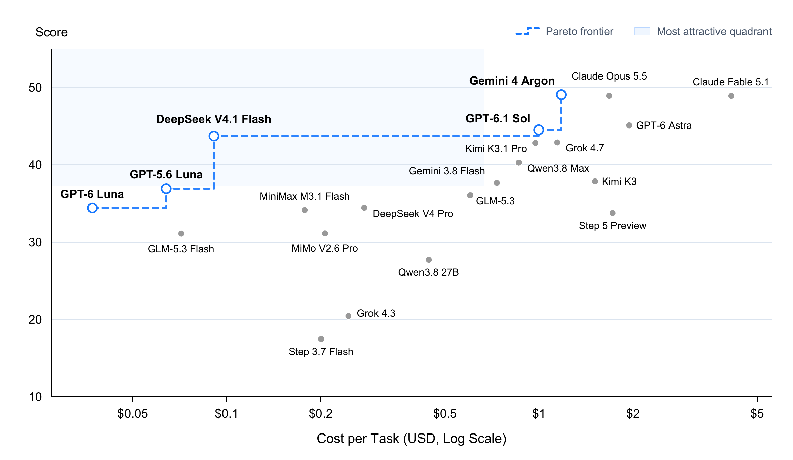

  

  <strong>Benchmarking AI for Inclusive Healthcare</strong>

  <a href="https://inclusionmed.ai/">Website</a> ·
  <a href="https://arxiv.org/abs/2611.21218">Paper</a> ·
  <a href="#news">News</a> ·
  <a href="#contributions">Contributions</a> ·
  <a href="https://inclusionmed.ai/#/contribute">Contribution form</a> ·
  <a href="https://github.com/panuvi/inclusionmed/blob/main/CONTRIBUTING.md">Contribution guide</a>

**InclusionMed** is an open evaluation initiative for inclusive healthcare. Through successive releases of the Atlas and Index, this open collaboration aims to ensure that the diverse healthcare needs of people worldwide guide how progress in medical AI is defined and measured.

The **InclusionMed Atlas** organizes benchmarks along two axes: healthcare role and AI capability. The role axis distinguishes patients and the public, healthcare professionals, and healthcare administration professionals; the capability axis distinguishes knowledge, reasoning, and agency. The Atlas design makes clear which healthcare needs are represented by the included benchmarks and where coverage remains limited.

The **InclusionMed Index** aggregates model results across the benchmarks included in the Atlas. In the initial release, each model's Index score is the equally weighted mean of its five benchmark scores. The Index also reports scores by healthcare role and AI capability, revealing differences in both model rankings and score levels.

## News

- **2026-11-16:** Release of the [InclusionMed Technical Report](https://arxiv.org/pdf/2611.21218).

## Current release

The current release evaluates 22 models on five benchmarks. Explore the [interactive Atlas and Index](https://inclusionmed.ai/) for benchmark details, model profiles and results.

### InclusionMed Atlas

Hatched cells indicate gaps in the current portfolio; † denotes a private benchmark.

### Overall InclusionMed Index

The Overall Index is the equally weighted mean of the five benchmark scores. Higher scores indicate stronger performance on the current portfolio. [Explore the rankings](https://inclusionmed.ai/#/index/overall).

### Cost–performance frontier

Scores and mean costs per task run are averaged equally across the five benchmarks. Costs are estimated from recorded token usage and published prices, in USD on a logarithmic axis. Open circles and the dashed line mark the observed Pareto frontier. [Explore the interactive chart](https://inclusionmed.ai/#intelligence-cost).

## Rationale and principles

The meaning of an overall score depends on what the included benchmarks assess and whose needs they represent. For inclusive healthcare, this raises the question of how benchmarks can be selected and organized so that an index reflects diverse needs and supports comparisons relevant to different uses of medical AI.

We audit candidate benchmarks to assess their suitability for medical AI evaluation and their contribution to the InclusionMed benchmark portfolio. The same six criteria apply to public and private benchmarks:

1. **Healthcare relevance.** We assess whether a benchmark or its healthcare-relevant subset addresses identifiable healthcare needs or activities, based on task objectives and intended users.
2. **Trustworthiness.** We review data provenance, benchmark construction, annotation, and scoring to assess whether reference standards and scoring criteria have a sound medical or professional basis and align with evaluation objectives. For example, we examine the methods and evidence used to establish ground truth and exclude benchmarks generated entirely by AI.
3. **Availability and permitted use.** We assess the availability of evaluation resources, including tasks, scoring methods, code, and execution environments. We review documented access routes, restrictions, and licence terms to determine which resources can be used for evaluation.
4. **Complementary coverage.** We assess whether a candidate adds value relative to the existing portfolio through its purpose, task design, or evaluation methods, including broader coverage of healthcare roles, AI capabilities, populations, languages, regions, or resource settings.
5. **Timeliness and data independence.** We assess whether task content and reference standards remain applicable as guidelines, policies, and benchmark versions change. We review documented contamination and leakage safeguards and evidence of test-material exposure or reuse.
6. **Discriminative capacity.** We assess whether benchmark scores distinguish model performance under comparable evaluation conditions. Using publicly reported results from the same benchmark version, we examine score distributions and differences between models. This initial assessment informs which candidate benchmarks proceed to independent reproduction.

Benchmark inclusion in the InclusionMed Atlas proceeds through collection, auditing and independent reproduction. Human review accompanies the audit throughout to ensure accurate assessments.

## Contributions

InclusionMed welcomes contributions from anyone interested in medical AI evaluation. Community input can reveal gaps in coverage, improve evaluation resources and help interpret results.

### Ways to contribute

- **Benchmark.** Contributors can share benchmarks, datasets or evaluation tools, describing what they assess and which materials are available. The team works with contributors on review, reproduction and revisions under the [assessment principles above](#rationale-and-principles). Accepted benchmarks are released with their scope and limitations.
- **Benchmark idea.** Contributors can propose a healthcare question for a new benchmark, even without a dataset or evaluation method. The team helps clarify the need and develop an initial task. Any resulting benchmark follows the same review process.
- **Correction.** Contributors can flag an Index entry and provide evidence for a correction. The team checks the evidence, discusses unresolved questions with the contributor and publishes verified corrections with their sources.
- **Advisory & partnership.** Individuals can offer expert guidance, and organizations can propose partnerships. The team and contributors agree on the scope, roles and availability before confirming the collaboration.

### How to participate

1. **Submit a contribution form.** Open the **[Contribute page](https://inclusionmed.ai/#/contribute)** and complete the form to describe your contribution, provide contact details and relevant materials, and indicate any support needed.
2. **Develop it together.** The team follows up by email to agree on next steps. Before publication or announcement, the team and contributor confirm the outcome and contribution credits.

Further guidance is available in the **[contribution guide](CONTRIBUTING.md)**. Contributions and inquiries may also be sent to **[info@inclusionmed.ai](mailto:info@inclusionmed.ai)**.

## Resources and contact

- [Contribution guide](CONTRIBUTING.md) — submission and review procedures.
- [Data and code baseline](assets/docs/task-format.md) — formats and documentation for benchmark materials.
- [Evaluation-record checklist](assets/docs/inclusionmed-evaluation-checklist.md) — evaluation configuration, scoring and reporting requirements.
- [InclusionMed website](https://inclusionmed.ai/) · [info@inclusionmed.ai](mailto:info@inclusionmed.ai)
